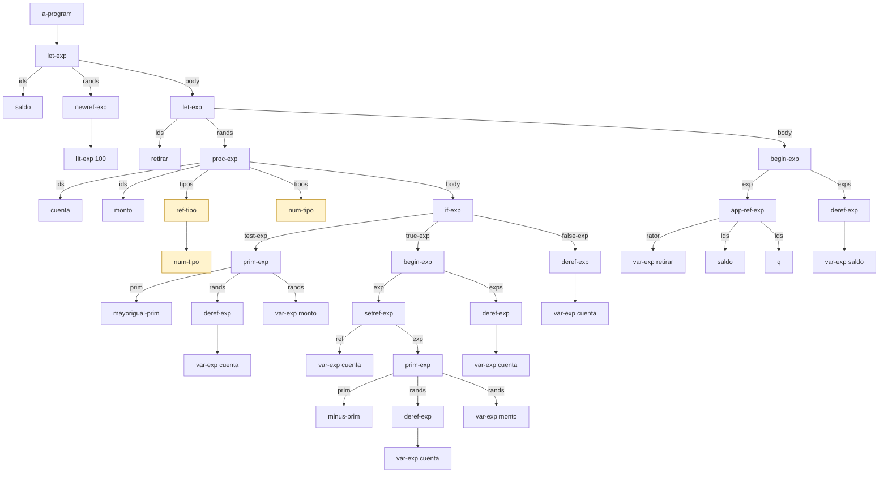
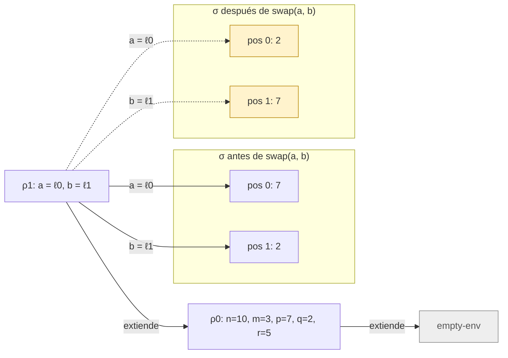

# Informe de AST y traza con almacén — Taller 3: Cauca con referencias y tipos

> Parte 4 del Taller 3. Todo el documento es Markdown, las fórmulas están en
> LaTeX y los diagramas en Mermaid.

**Curso:** Fundamentos de Interpretación y Compilación de Lenguajes
de Programación — Universidad del Valle, Sede Tuluá.

**Integrantes del grupo:**

| Nombre | Código | Correo institucional |
|--------|--------|----------------------|
| Oliver De Jesus Arboleda Baez | 2459684 | oliver.arboleda@correounivalle.edu.co |
| Maria Fernanda Betancourt Montoya | 2459510 | maria.fernanda.betancourt@correounivalle.edu.co |
| Kevin Andres Rosero Romo | 2459554 | rosero.kevin@correounivalle.edu.co |

---

## 1. Gramática considerada

Es la gramática del Taller 2 más las expresiones del almacén (Parte 1), el
paso por referencia (Parte 2) y las anotaciones de tipo en `proc` y `letrec`.
Los nombres de los constructores son los que genera SLLGEN en
`src/sintaxis.rkt`.

```bnf
<programa>  ::= <expresion>                                      a-program(exp)

<expresion> ::= <numero>                                         lit-exp(dato)
            ::= <identificador>                                  var-exp(id)
            ::= "true"                                           true-exp()
            ::= "false"                                          false-exp()
            ::= <primitiva> "(" {<expresion>}*(,) ")"            prim-exp(prim, rands)
            ::= "if" <expresion> "then" <expresion>
                "else" <expresion> "end"                         if-exp(test-exp, true-exp, false-exp)
            ::= "let" {<identificador> "=" <expresion>}*
                "in" <expresion> "end"                           let-exp(ids, rands, body)
            ::= "proc" "(" {<identificador> ":" <tipo>}*(,) ")"
                <expresion> "end"                                proc-exp(ids, tipos, body)
            ::= "apply" <expresion> "(" {<expresion>}*(,) ")"    app-exp(rator, rands)
            ::= "letrec" {<tipo> <identificador>
                "(" {<identificador> ":" <tipo>}*(,) ")"
                "=" <expresion>}* "in" <expresion> "end"         letrec-exp(tipos-res, proc-names, idss,
                                                                            tipos-args, bodies, body)
            ::= "case" <expresion> {"of" <numero> "=>" <expresion>}*
                "otherwise" "=>" <expresion> "end"               case-exp(control, valores, acciones, default)
            ::= "newref" "(" <expresion> ")"                     newref-exp(exp)
            ::= "deref" "(" <expresion> ")"                      deref-exp(exp)
            ::= "setref" "(" <expresion> "," <expresion> ")"     setref-exp(ref, exp)
            ::= "swap" "(" <expresion> "," <expresion> ")"       swap-exp(ref1, ref2)
            ::= "begin" <expresion> {";" <expresion>}* "end"     begin-exp(exp, exps)
            ::= "applyref" <expresion>
                "(" {<identificador>}*(,) ")"                    app-ref-exp(rator, ids)

<tipo>      ::= "num"                                            num-tipo()
            ::= "bool"                                           bool-tipo()
            ::= "refto" "(" <tipo> ")"                           ref-tipo(t)
            ::= "(" {<tipo>}*(*) "->" <tipo> ")"                 proc-tipo(args, res)

<primitiva> ::= "+" | "-" | "*" | "/" | "add1" | "sub1" | ">" | ">=" | "<"
              | "<=" | "==" | "not" | "and" | "or" | "abs" | "mcd" | "mcm"
              | "promedio" | "xor" | "implica" | "entre"
                (sum-prim, minus-prim, mult-prim, div-prim, add-prim, sub-prim,
                 mayor-prim, mayorigual-prim, menor-prim, menorigual-prim,
                 igual-prim, not-prim, and-prim, or-prim, abs-prim, mcd-prim,
                 mcm-prim, promedio-prim, xor-prim, implica-prim, entre-prim)
```

---

## 2. Ejemplos de AST

### Ejemplo 1 — Retiro de una cuenta con `applyref`

**Expresión concreta:**

```scheme
let saldo = newref(100)
in
  let retirar = proc (cuenta : refto(num), monto : num)
                  if >=(deref(cuenta), monto)
                  then begin
                         setref(cuenta, -(deref(cuenta), monto));
                         deref(cuenta)
                       end
                  else deref(cuenta)
                  end
                end
  in
    begin
      applyref retirar (saldo, q);
      deref(saldo)
    end
  end
end
```

**AST** (las aristas llevan el nombre del campo del constructor; los nodos
de tipo van resaltados):



**Explicación.** La raíz es `a-program` y su hijo es el `let-exp` externo, que
liga `saldo` a `newref-exp(lit-exp 100)`. Su cuerpo es otro `let-exp` que liga
`retirar` a un `proc-exp`. El `proc-exp` guarda en paralelo la lista de
parámetros `[cuenta, monto]` y la lista de tipos
`[ref-tipo(num-tipo), num-tipo]`: los nodos de tipo forman parte del árbol,
aunque el intérprete los ignore. El cuerpo del procedimiento es un `if-exp`
cuya condición es `prim-exp(mayorigual-prim, [deref-exp(...), var-exp monto])`.
La rama `then` es un `begin-exp` con un `setref-exp` seguido de un `deref-exp`,
y la rama `else` es un `deref-exp`. El cuerpo del `let` interno es un
`begin-exp` cuya primera expresión es un `app-ref-exp`: a diferencia de
`app-exp`, sus argumentos no son expresiones sino identificadores
(`saldo` y `q`) y por eso son hojas, no subárboles.

**Por qué el programa, tal como está escrito, no pasa el chequeador.**
El segundo argumento de `applyref` es `q`, que en el ambiente inicial está
ligado a `2`, un número, no a una referencia. La regla de tipado de
`applyref` pide que cada identificador $x_i$ cumpla $\Gamma(x_i) = t_i$ con
$t_i = \text{refto}(s_i)$:

$$
\frac{\Gamma \vdash f : (t_1 * \cdots * t_n \to t) \qquad
      \Gamma(x_i) = t_i \qquad t_i = \text{refto}(s_i)}
     {\Gamma \vdash \text{applyref } f(x_1, \ldots, x_n) : t}
$$

Aquí $\Gamma(\texttt{q}) = \text{num}$, que no es de la forma $\text{refto}(s)$.
Hay además un segundo conflicto: el parámetro `monto` se declaró
`monto : num`, y con `applyref` todos los parámetros deben ser
$\text{refto}(\cdot)$. Al ejecutar el chequeador del repositorio sobre este
programa se obtiene:

```text
type-of: El paso por referencia exige variables ligadas a referencias
```

Si se saltara el chequeador, el intérprete falla con el mismo mensaje en
tiempo de ejecución, porque `q` no se evalúa a una referencia.

**Corrección mínima.** Hay que dar a `applyref` lo que exige: un parámetro de
tipo `refto(num)` y un argumento ligado a una referencia.

```scheme
let saldo = newref(100)
in
  let retirar = proc (cuenta : refto(num), monto : refto(num))
                  if >=(deref(cuenta), deref(monto))
                  then begin
                         setref(cuenta, -(deref(cuenta), deref(monto)));
                         deref(cuenta)
                       end
                  else deref(cuenta)
                  end
                end
  in
    let m = newref(q)
    in
      begin
        applyref retirar (saldo, m);
        deref(saldo)
      end
    end
  end
end
```

Los cambios son tres: `monto : refto(num)`, cada uso de `monto` pasa a
`deref(monto)` y se crea `m = newref(q)` para tener una referencia que pasar.
Con esto el chequeador da el tipo `num` y el intérprete retorna `98`
(el saldo de 100 menos el retiro de 2).

Cambiar solamente `applyref` por `apply` *sí* pasa el chequeador (los tipos
$(\text{refto}(\text{num}) * \text{num} \to \text{num})$ coinciden con los
argumentos), pero no es una corrección: el programa retorna `100`, porque
`apply` entrega a `retirar` una copia de la celda y el retiro se pierde.

---

## 3. Traza de evaluación con el estado del almacén

**Expresión a evaluar** (segundo ejemplo guía de la Parte 1):

```scheme
let a = newref(7)
    b = newref(2)
in
  begin
    swap(a, b);
    +(deref(a), *(10, deref(b)))
  end
end
```

**Ambiente inicial:** $\rho_0 = [\,n = 10,\ m = 3,\ p = 7,\ q = 2,\ r = 5\,]$.
El almacén empieza vacío: $\sigma = [\ ]$. Al evaluar el cuerpo del `let` el
ambiente pasa a ser $\rho_1 = [\,a = \ell_0,\ b = \ell_1\,] \cdot \rho_0$,
donde $\ell_i$ es la referencia `a-ref(i)` a la celda de posición $i$. Se usa
la notación $\sigma = [\,0 \mapsto v_0,\ 1 \mapsto v_1,\ \ldots\,]$ y la flecha
$\to$ en la columna del almacén separa el estado antes y después de evaluar
la expresión.

**Traza** (en el orden en que se evalúa):

| # | Expresión evaluada | Ambiente | Almacén $\sigma$ | Valor resultante |
|---|--------------------|----------|------------------|------------------|
| 1 | `let a = newref(7) b = newref(2) in … end` | $\rho_0$ | $[\ ]$ | $72$ (se obtiene en la fila 12) |
| 2 | `newref(7)` | $\rho_0$ | $[\ ] \to [0 \mapsto 7]$ | $\ell_0$ |
| 3 | `newref(2)` | $\rho_0$ | $[0 \mapsto 7] \to [0 \mapsto 7,\ 1 \mapsto 2]$ | $\ell_1$ |
| 4 | `begin swap(a, b); +(…) end` (cuerpo del `let`) | $\rho_1$ | $[0 \mapsto 7,\ 1 \mapsto 2]$ | $72$ (fila 11) |
| 5 | `a` y `b` (argumentos de `swap`) | $\rho_1$ | $[0 \mapsto 7,\ 1 \mapsto 2]$ | $\ell_0$ y $\ell_1$ |
| 6 | `swap(a, b)` | $\rho_1$ | $[0 \mapsto 7,\ 1 \mapsto 2] \to [0 \mapsto 2,\ 1 \mapsto 7]$ | $2$ |
| 7 | `deref(a)` | $\rho_1$ | $[0 \mapsto 2,\ 1 \mapsto 7]$ | $2$ |
| 8 | `deref(b)` | $\rho_1$ | $[0 \mapsto 2,\ 1 \mapsto 7]$ | $7$ |
| 9 | `*(10, deref(b))` | $\rho_1$ | $[0 \mapsto 2,\ 1 \mapsto 7]$ | $70$ |
| 10 | `+(deref(a), *(10, deref(b)))` | $\rho_1$ | $[0 \mapsto 2,\ 1 \mapsto 7]$ | $72$ |
| 11 | `begin … end` | $\rho_1$ | $[0 \mapsto 2,\ 1 \mapsto 7]$ | $72$ |
| 12 | `let … end` (programa completo) | $\rho_0$ | $[0 \mapsto 2,\ 1 \mapsto 7]$ | $72$ |

En la fila 6, `swap` lee los dos contenidos ($7$ y $2$) *antes* de escribir,
escribe $2$ en $\ell_0$ y $7$ en $\ell_1$, y retorna $2$: el valor que quedó
en la primera referencia, que es el contenido anterior de la segunda celda.
El `begin` descarta ese valor y retorna el de su última expresión.

**Cadena de ambientes y las dos instantáneas del almacén.** La cadena va
completa, con el ambiente vacío al final; cada flecha sale del ambiente que
extiende y llega al ambiente al que extiende. Las flechas continuas apuntan a
las celdas antes del `swap` y las punteadas a las mismas celdas después.



**Explicación.** `swap` no intercambia las referencias, intercambia los
*contenidos*: `a` sigue ligada a $\ell_0$ y `b` a $\ell_1$ antes y después, y
lo que cambia es el valor de cada celda. Por eso `deref(a)` pasa de $7$ a $2$ y
`deref(b)` de $2$ a $7$.

### 3.1 La misma idea con `apply` en lugar de `applyref`

Programa de contraste de la Parte 2, con `applyref`:

```scheme
let x = newref(11)
    y = newref(4)
in
  let intercambiar = proc (u : refto(num), v : refto(num)) swap(u, v) end
  in
    begin
      applyref intercambiar (x, y);
      -(deref(x), deref(y))
    end
  end
end
```

`applyref` liga $u \mapsto \ell_0$ y $v \mapsto \ell_1$, las mismas referencias
de `x` e `y`. El `swap` actúa sobre las celdas originales:
$\sigma = [0 \mapsto 11,\ 1 \mapsto 4] \to [0 \mapsto 4,\ 1 \mapsto 11]$, y el
programa retorna $4 - 11 = -7$.

Con `apply` en lugar de `applyref` (`apply intercambiar (x, y)`) el programa
sigue siendo bien tipado, pero retorna $7$. Para un valor que es una
referencia, la copia por valor *reserva una celda nueva con el mismo
contenido*: $u$ queda ligado a $\ell_2$ con $\sigma(\ell_2) = 11$ y $v$ a
$\ell_3$ con $\sigma(\ell_3) = 4$. El `swap` intercambia esas dos celdas
nuevas:

$$
\sigma = [0 \mapsto 11,\ 1 \mapsto 4] \;\to\;
[0 \mapsto 11,\ 1 \mapsto 4,\ 2 \mapsto 4,\ 3 \mapsto 11]
$$

y las celdas $\ell_0$ y $\ell_1$ de `x` e `y` no se tocan, así que
`-(deref(x), deref(y))` es $11 - 4 = 7$. Este es el programa que separa los
dos mecanismos: la diferencia $-7$ contra $7$ es exactamente la diferencia
entre compartir la celda y recibir una copia.

---

## 4. Estado del almacén en una transacción

No aplica: Cauca con referencias y tipos no tiene bloques `atomic` ni
transacciones, y el enunciado de este taller no pide el ejercicio. El estado
del almacén se muestra en la sección 3, antes y después del `swap`.

---

## 5. Referencias

- Friedman, D. P., & Wand, M. *Essentials of Programming Languages*,
  3.ª ed., MIT Press, 2008. Sección 2.2 (ambientes), sección 4.2
  (EXPLICIT-REFS, almacén y referencias), sección 4.3 (paso por referencia)
  y sección 7.2 (anotaciones de tipo del lenguaje CHECKED).
- Pierce, B. C. *Types and Programming Languages*, MIT Press, 2002.
  Capítulo 13 (referencias).
